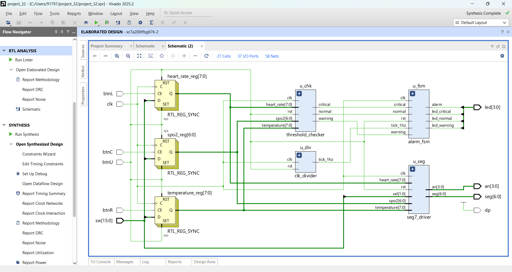
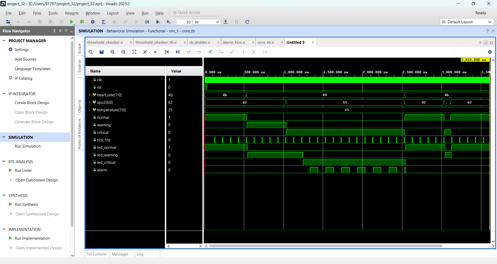
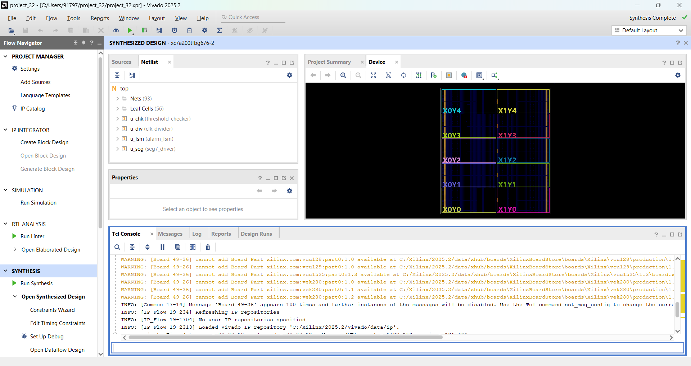
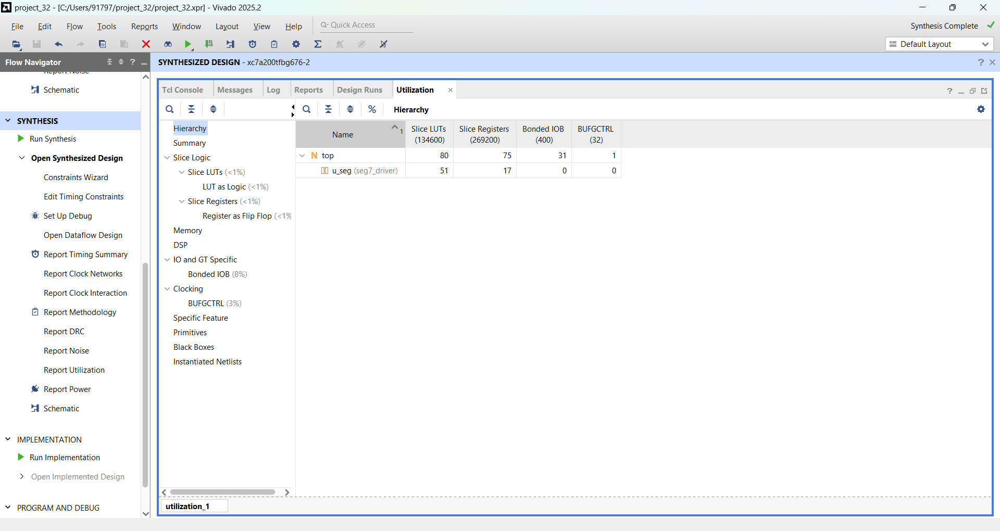

# Hospital Patient Monitoring System

A Verilog-based patient monitoring system designed and simulated in Xilinx Vivado (target: Artix-7 xc7a200t).
It checks heart rate, SpO2 and body temperature, classifies the patient as Normal, Warning or Critical, and raises a blinking alarm for sustained critical conditions.

## Modules

| File | Description |
|---|---|
| threshold_checker.v | Compares the 3 vitals with thresholds and gives normal / warning / critical |
| ck_divider.v | Divides 100 MHz clock to a 1 Hz tick (module name: clk_divider) |
| alarm_fsm.v | FSM (Normal, Warning, Critical). Critical must last 2 ticks before the alarm, which filters out false alarms. Alarm blinks at 1 Hz |
| seg7_driver.v | Shows heart rate, SpO2 or temperature on a 4-digit 7-segment display |
| top.v | Connects all modules. Input registers load values from switches using buttons |
| threshold_checker_tb.v | Testbench for the threshold checker |
| core_tb.v | Testbench for threshold checker + clock divider + alarm FSM |

## Thresholds

| Parameter | Normal | Warning | Critical |
|---|---|---|---|
| Heart rate (bpm) | 60 - 100 | 50 - 59 or 101 - 120 | < 50 or > 120 |
| SpO2 (%) | >= 95 | 90 - 94 | < 90 |
| Temperature (C) | 36 - 37 | 35 or 38 | <= 34 or >= 39 |

The worst of the three vitals decides the final status.

## Results

### Schematic

### Simulation waveform
Normal, Warning, then Critical (alarm blinking), back to Normal, and a short spike that is ignored by the FSM.

### Synthesis

### Utilization
Uses 80 LUTs and 75 flip-flops (less than 1% of the device).

## How to run

1. Create a Vivado RTL project and add the files from this repository.
2. Add threshold_checker_tb.v and core_tb.v as simulation sources.
3. Set core_tb as top, run Behavioral Simulation, then use run all.
4. For synthesis, set top as top module and click Run Synthesis.

## Status

Simulation and synthesis are complete. Pin constraints for a physical board are not added yet.
